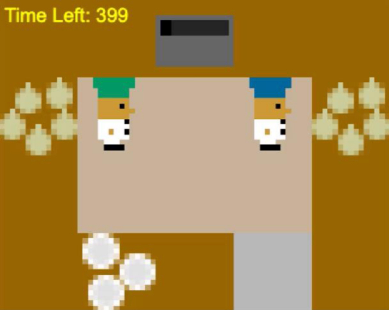
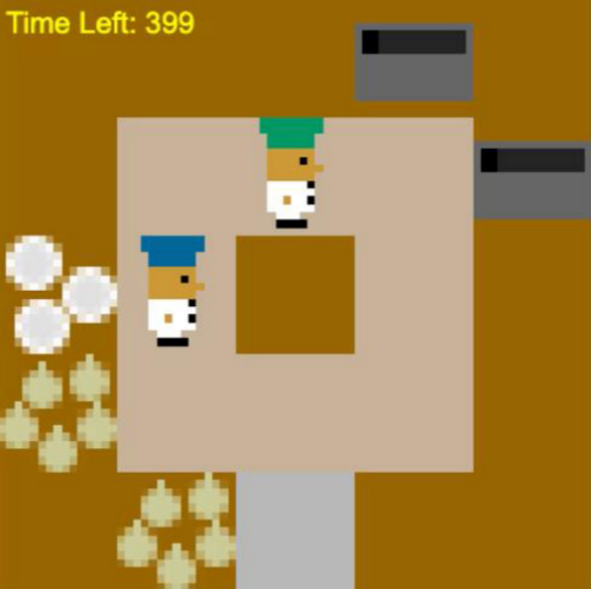
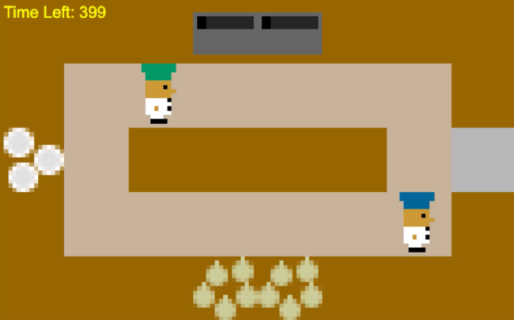
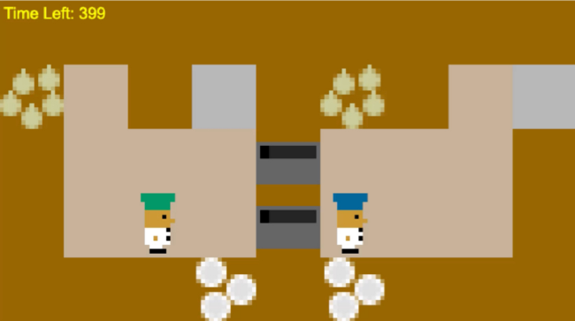
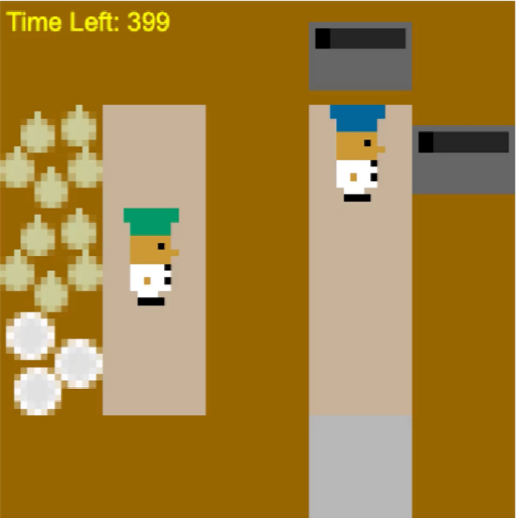

# Overcooked agents

The task originates from [Overcooked-AI](https://github.com/HumanCompatibleAI/overcooked_ai), introduced by Carroll et al. (2019), *On the Utility of Learning about Humans for Human-AI Coordination*. This repository runs training and evaluation through the [JaxMARL](https://github.com/FLAIROx/JaxMARL) implementation of the environment.

Run the following commands from the repository root using `overcooked/environment.yml`.

## Overcooked layouts

The five Overcooked-AI layouts impose different spatial and task-coordination demands.

| Layout | Collaboration challenge | Layout structure |
|---|---|---|
| Cramped Room | Constrained shared-space coordination |  |
| Coordination Ring | Narrow-path movement coordination |  |
| Counter Circuit | Counter-mediated task handoffs |  |
| Asymmetric Advantages | Role-asymmetric task coordination |  |
| Forced Coordination | Mandatory inter-agent handoffs |  |

## Train

Train self-play baselines into a fresh output directory:

```bash
python overcooked/run_baseline_pipeline.py \
  --baselines-dir results/overcooked/new_baselines --n-workers 4 \
  --pbt-interval 100 --num-steps 4096 --total-updates 5000 \
  --shaping-pick-onion 1 --shaping-place-onion 5 \
  --shaping-pick-dish 2 --shaping-deliver-soup 5 --seed 0
```

Fine-tune competence-conditioned agents using the released self-play baselines and partner population:

```bash
python overcooked/run_agent_pipeline.py \
  --agents overcooked/configs/Train1a.json \
  --clones-dir overcooked/artifacts/partners \
  --clones-scores overcooked/artifacts/partners/competence_labels.json \
  --baselines-dir overcooked/artifacts/baselines \
  --out-dir results/overcooked/new_agents \
  --num-steps 4096 --ppo-epochs 4 \
  --shaping-pick-onion 1 --shaping-place-onion 5 --shaping-pick-dish 2 \
  --shaping-plate-soup 5 --shaping-deliver-soup 5 --seed 0
```

`Train1a` = Cramped Room, `1b` = Coordination Ring, `1c` = Asymmetric Advantages, `1d` = Counter Circuit, `1e` = Forced Coordination. The original competence-policy launch settings used 4096 rollout steps for a/b/e and 2048 for c/d. JSON configurations contain update counts, partner pools, and stopping settings. Consult each training entry point's `--help` for overrides. Some historical flags are retained for compatibility; notably the adaptive trainer does not use the plate-soup shaping flag. The release preserves that behavior rather than altering the original algorithm.

## Evaluate released agents

```bash
python overcooked/evaluate_agents.py \
  --scripts overcooked/configs/Train1a.json \
  --models-dir overcooked/artifacts/agents \
  --clones-dir overcooked/artifacts/partners \
  --clones-scores overcooked/artifacts/partners/competence_labels.json \
  --train-sets overcooked/configs/splits.json \
  --baselines-dir overcooked/artifacts/baselines \
  --out-dir results/overcooked/evaluation/agents_competence_with_logs \
  --n-trials 10 --max-steps 400 --robustness-sweep --save-trial-logs

python overcooked/metrics/evaluate_metrics.py \
  --evaluation-root results/overcooked --out-dir results/overcooked/metrics
```

Repeat the evaluator for Train1b–e into the same evaluation directory, or pass all five JSONs to `--scripts`. To evaluate new training runs, point `--models-dir` at their output directory. Choose new output directories when changing experiment settings; the evaluator can resume existing CSVs.

## Cross-layout transfer

```bash
python overcooked/evaluate_cross_layout_competence_logged.py \
  --repo overcooked --n-trials 10 --max-clones 0 --workers 4 \
  --out-dir results/overcooked/cross_layout
```

This uses competence-aligned beliefs, rather than the main full belief sweep, and includes same-layout comparisons unless `--off-diagonal-only` is set. `--dry-run` validates inputs and prints coverage without simulation. The cross-layout runner retains `evaluate_agents_v3.py` because it depends on that evaluator version. It writes event/trial summaries separately; the main metric replay CLI consumes the main evaluator's action-log schema.

The provided partners are fixed inputs. Training those human-proxy partners from raw gameplay is outside this release.
